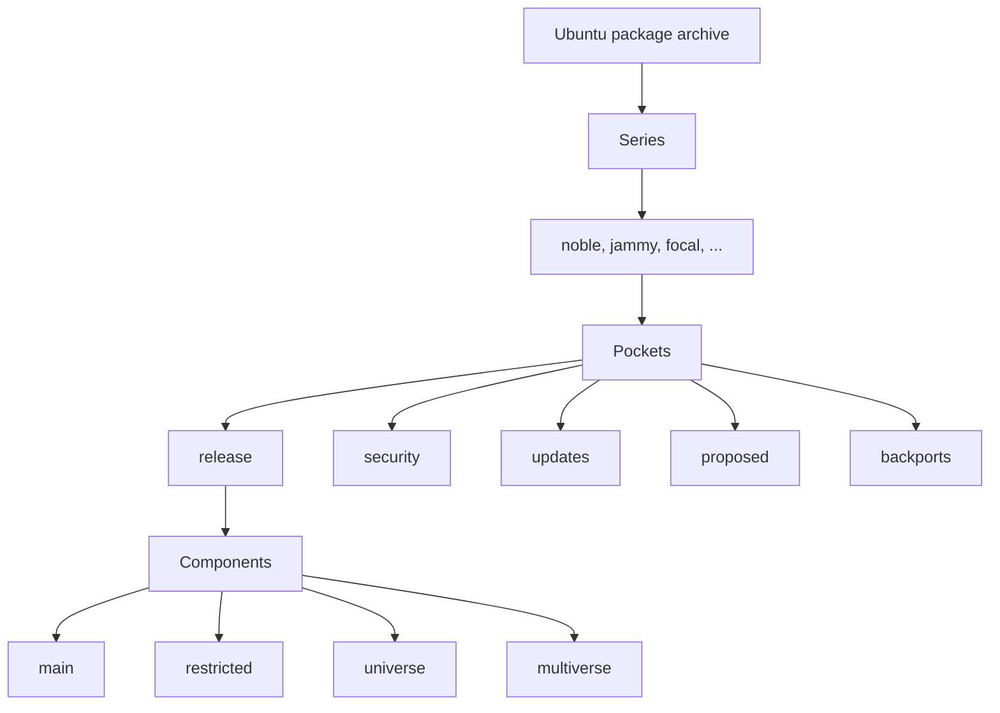

# AGENTS.md

Guidance for AI agents and contributors working in this repository.

## Project overview

`ubuntu-info-rust` is a Rust library that models Ubuntu distribution information
as **static data structures and enums**. It is a dependency-light, compile-time
source of truth for Ubuntu series, archive pockets, suites, components, machine
architectures, and archive locations. Series lookups use compile-time perfect
hash maps (`phf`), so they are O(1) in the number of series.

The crate performs no network requests and reads no system files. All data is
`const`/`static`, and all public APIs are documented with rustdoc.

Authoritative references for the domain:

- <https://ubuntu.com/project/docs/how-ubuntu-is-made/concepts/package-archive/>
- <https://ubuntu.com/project/docs/release-team/list-of-releases/>
- <https://ubuntu.com/project/docs/how-ubuntu-is-made/concepts/supported-architectures/>

## Quick reference

| Module | Responsibility |
| --- | --- |
| `src/lib.rs` | Crate documentation and public re-exports |
| `src/series.rs` | `SeriesInfo`, `Lifecycle`, `SERIES`, `REFERENCE_DATE`, perfect-hash lookup maps, iterators |
| `src/pocket.rs` | `Pocket` enum and suite suffixes |
| `src/component.rs` | `Component` enum and classification helpers |
| `src/architecture.rs` | `Architecture` and `Endianness` enums |
| `src/suite.rs` | `Suite` (series + pocket) parsing and formatting |
| `src/archive.rs` | `Archive` locations and URL construction |
| `src/date.rs` | Dependency-free `Date` type |
| `src/error.rs` | `ParseError` |
| `tests/public_api.rs` | Public API integration tests |
| `examples/` | Runnable usage examples |

## Domain model

The Ubuntu package archive is layered:



### Series

A **series** is the set of packages targeting one Ubuntu version, identified by
its code name (`noble`, `jammy`, `focal`, `trusty`, ...). A series is *not* the
same as a release: an LTS series has one initial release plus point releases
(e.g. 22.04, 22.04.1, 22.04.2 are all `jammy`). The crate models both the code
name and the version (e.g. `24.04`), plus LTS status and lifecycle information.

The special `devel` series always mirrors the series currently in development. It
is an alias, not a distinct series; `SeriesInfo::devel()` resolves it rather than
storing duplicate data.

### Pockets

Every series has five pockets:

| Pocket      | Purpose                                                                 |
| ----------- | ----------------------------------------------------------------------- |
| `release`   | Packages the series shipped with; frozen after initial release.         |
| `security`  | Security-related updates to `release`.                                  |
| `updates`   | Non-security updates to `release`.                                      |
| `proposed`  | Staging area for updates before they reach `release`/`updates`.         |
| `backports` | Packages the series did not ship with; **no security support guarantee**. |

### Suites

A **suite** is the combination of a series and a pocket. The `release` pocket has
no suffix; all other pockets append `-<pocket>`:

| Suite             | Series  | Pocket      |
| ----------------- | ------- | ----------- |
| `jammy`           | `jammy` | `release`   |
| `jammy-security`  | `jammy` | `security`  |
| `jammy-updates`   | `jammy` | `updates`   |
| `jammy-proposed`  | `jammy` | `proposed`  |
| `jammy-backports` | `jammy` | `backports` |

Suite parsing and formatting round-trip for canonical suites:
`Suite::from_str(s).to_string() == s`. The `devel` aliases (`devel`,
`devel-security`, ...) resolve to the development series and its corresponding
pocket; formatting a resolved `devel` suite produces the canonical series name
(for example, `devel-security` formats as `tenacious-security`).

### Components

Components subdivide the packages within a suite:

|                    | Open source | Closed source |
| ------------------ | ----------- | ------------- |
| **Ubuntu base**    | `main`      | `restricted`  |
| **Community**      | `universe`  | `multiverse`  |

`main` and `restricted` are maintained by Canonical; `universe` and `multiverse`
by the community. `multiverse` covers software that does not meet the full open
source definition, not only closed-source software.

### Architectures

The crate models the officially supported machine architectures (`amd64`,
`amd64v3`, `arm64`, `armhf`, `ppc64el`, `riscv64`, `s390x`) plus the partial
`i386` port. `Architecture::is_officially_supported()` returns `false` for
`i386`. `amd64v3` is the `x86-64-v3` architecture variant introduced in Ubuntu
25.10.

### Archive locations

- Primary archive: `http://archive.ubuntu.com/ubuntu`
- Security updates: `http://security.ubuntu.com/ubuntu` (same servers, separate
  hostname so the security pocket is not accidentally redirected to a mirror)
- Ports archive: `http://ports.ubuntu.com/ubuntu-ports` for `arm64`, `armhf`,
  `ppc64el`, `riscv64`, and `s390x`
- Country mirrors: `<country-code>.archive.ubuntu.com`
- Distribution layout: `dists/<suite>/<component>/binary-<arch>/`

URLs and hostnames are data in `src/archive.rs`, not hard-coded string
concatenation scattered through the code. `Archive::for_architecture` and
`Archive::security_for_architecture` map each architecture to the archive that
hosts it.

## Implemented API

### `SeriesInfo`

```rust
pub struct SeriesInfo {
    pub code_name: &'static str,            // "Stonking Stingray"
    pub code_name_short: &'static str,      // "stonking"
    pub version: &'static str,              // "26.10"
    pub release_date: Date,
    pub end_of_standard_support: Date,
    pub end_of_life: Date,
    pub esm_start: Option<Date>,
    pub legacy_start: Option<Date>,
    pub is_lts: bool,
}
```

`SeriesInfo` implements `Ord` by `release_date`, with the remaining fields as
tie-breakers so the ordering is consistent with `Eq`.

Lookups:

- `SeriesInfo::from_version(input)` accepts `"26.04"`, `"26.04 LTS"`,
  `"Ubuntu 26.04 LTS"`, and LTS point releases such as `"24.04.1 LTS"`. An LTS
  suffix or point release is rejected for a non-LTS series.
- `SeriesInfo::from_code_name(input)` accepts the full code name
  (`"Stonking Stingray"`) or the short code name (`"stonking"`), ASCII
  case-insensitively. `"devel"` resolves to `SeriesInfo::devel()`.
- `SeriesInfo::from_short_name(input)` accepts only short code names (and
  `"devel"`).

All lookups are O(1) in the number of series. They use the private
`VERSION_INDEX`, `SHORT_NAME_INDEX`, and `FULL_NAME_INDEX` perfect hash maps,
which store indices into `SERIES`. `devel()` uses the `DEVEL_INDEX` constant.
When adding or reordering series, update these maps and `DEVEL_INDEX`; the
`lookup_maps_match_series_data` and `devel_index_is_correct` tests verify them.

Iterators:

- `all()` — every known series, ordered by release date.
- `active()` — released series that are still supported (standard support, ESM,
  or legacy support). The future release is excluded.
- `esm()` — series that have entered ESM, including those that have since moved
  to legacy support or end of life.
- `current_esm()` — series currently in the ESM phase.
- `legacy()` — series that have entered Ubuntu Pro legacy support.
- `current_legacy()` — series currently in the legacy support phase.
- `end_of_life()` — series that have reached end of life.
- `devel()` — the unreleased series with the earliest release date relative to
  `REFERENCE_DATE`.

Lifecycle methods:

- `lifecycle_on(date)` returns a `Lifecycle`.
- `is_active_on(date)`, `is_esm_on(date)`, `is_legacy_on(date)`, and
  `is_end_of_life_on(date)` return `bool`.

Dates are inclusive: a series remains in a phase through the last day of that
phase.

### `Lifecycle`

```rust
pub enum Lifecycle {
    Development,
    StandardSupport,
    ExpandedSecurityMaintenance,
    LegacySupport,
    EndOfLife,
}
```

Variants are ordered from `Development` through `EndOfLife`.

### `Pocket`

```rust
pub enum Pocket {
    Release,
    Security,
    Updates,
    Proposed,
    Backports,
}
```

- `Pocket::ALL` lists all variants.
- `Pocket::as_str()` returns the canonical identifier.
- `Pocket::suffix()` returns `""` for `Release` and `"-security"`,
  `"-updates"`, `"-proposed"`, or `"-backports"` for the others.
- Implements `Display` and `FromStr`.

### `Component`

```rust
pub enum Component {
    Main,
    Restricted,
    Universe,
    Multiverse,
}
```

- `Component::ALL` lists all variants.
- `Component::as_str()` returns the canonical identifier.
- `is_canonical()`, `is_community()`, and `is_open_source()` classify components.
- Implements `Display` and `FromStr`.

### `Architecture` and `Endianness`

```rust
pub enum Architecture {
    Amd64,
    Amd64v3,
    Arm64,
    Armhf,
    I386,
    Ppc64el,
    Riscv64,
    S390x,
}

pub enum Endianness {
    Little,
    Big,
}
```

- `Architecture::ALL` lists all variants.
- `Architecture::as_str()` returns the canonical identifier.
- `Architecture::endianness()` returns the byte order.
- `Architecture::is_officially_supported()` returns `false` for `I386`.
- `Architecture::archive()` and `security_archive()` return the `Archive` that
  hosts the architecture.
- `Architecture::archive_url()` and `security_archive_url()` return the base
  URLs for the architecture.
- `Architecture::dists_url(suite, component)` and
  `security_dists_url(suite, component)` return full archive URLs.
- Implements `Display` and `FromStr`.

### `Suite`

```rust
pub struct Suite {
    pub series: &'static SeriesInfo,
    pub pocket: Pocket,
}
```

- `Suite::new(series, pocket)` constructs a suite.
- `Suite::devel(pocket)` constructs a suite for the development series.
- Implements `Ord` by the `series` field, then the `pocket` field.
- Implements `Display` and `FromStr`.

### `Archive`

```rust
pub enum Archive {
    Primary,
    Security,
    Ports,
    Country(&'static str),
}
```

- `Archive::PRIMARY_URL`, `Archive::SECURITY_URL`, and `Archive::PORTS_URL`
  expose the base URLs.
- `Archive::country(code)` constructs a country mirror.
- `Archive::for_architecture(architecture)` returns the primary archive that
  hosts the architecture.
- `Archive::security_for_architecture(architecture)` returns the security
  archive that hosts the architecture.
- `base_url()` returns the archive base URL.
- `dists_path(suite, component, architecture)` returns
  `dists/<suite>/<component>/binary-<arch>/`.
- `dists_url(...)` returns the full URL.
- Implements `Display`.

### `Date`

- `Date::new(year, month, day)` validates the date and is usable in `const`
  contexts.
- `Date::year_month(year, month)` returns the first day of the month.
- `Date::end_of_month(year, month)` returns the last day of the month.
- `year()`, `month()`, and `day()` accessors.
- Implements `Display`, `FromStr`, `Ord`, and `Copy`.

### `ParseError`

`ParseError` is returned by `FromStr` implementations for pockets, components,
architectures, suites, and dates. It implements `Display` and
`std::error::Error`.

All public types implement serde's `Serialize` and `Deserialize` traits when
the optional `serde` feature is enabled. Enums serialize as their canonical
identifiers, and `Date` serializes as `YYYY-MM-DD`. `SeriesInfo` and `Suite`
deserialize by resolving against the built-in series data, so the input must
describe a known series exactly. `Archive::Country` deserialization allocates
and leaks the country code so it can be stored with a `'static` lifetime.

## Data maintenance

The series data lives in `SERIES` in `src/series.rs`. When updating it:

1. Keep entries in release-date order.
2. Update the `VERSION_INDEX`, `SHORT_NAME_INDEX`, and `FULL_NAME_INDEX` maps so
   each key points at the correct index in `SERIES`.
3. Update `DEVEL_INDEX` if the development series changes.
4. Update `REFERENCE_DATE` when the data has been re-verified. The "current"
   iterators use this date.
5. Use `Date::year_month` for month-precision start dates and
   `Date::end_of_month` for month-precision end dates.
6. Keep lifecycle dates consistent:
   - `release_date <= end_of_standard_support <= end_of_life`
   - `esm_start <= end_of_life`
   - `legacy_start <= end_of_life`
7. Run the test suite. The tests enforce unique versions, short names, and full
   names, release-date order, lifecycle-date consistency, and lookup-map
   consistency.
8. Update `README.md` and any affected examples when the public API or supported
   data changes.

For LTS series before 12.04, the server lifecycle is used. `i386` is modeled as a
partial port.

## Repository layout

```
src/lib.rs                    Library root and public API
src/series.rs                 Series data, lookups, lifecycle, iterators
src/pocket.rs                 Pocket enum
src/component.rs              Component enum
src/architecture.rs           Architecture and Endianness enums
src/suite.rs                  Suite type
src/archive.rs                Archive locations and URL construction
src/date.rs                   Date type
src/error.rs                  ParseError
tests/public_api.rs           Public API integration tests
tests/serde.rs                Serde round-trip tests (requires the serde feature)
examples/                     Runnable usage examples
Cargo.toml                    Crate manifest (edition 2024; phf required, serde optional)
Cargo.lock                    Must be committed; CI builds with --locked
git-hooks/pre-commit          Tests, clippy, fmt, docs, and cargo audit
git-hooks/setup-hooks.sh      Symlinks hooks into .git/hooks
.github/workflows/            Build, lint, docs, test, and audit on pull requests
.devcontainer/                Canonical Ubuntu Rust devcontainer
```

## Development workflow

Enable the repository hooks once per clone:

```sh
./git-hooks/setup-hooks.sh
```

Run the same checks locally that CI runs:

```sh
cargo fmt -- --check
cargo clippy --locked --all-targets --all-features -- -D warnings
RUSTDOCFLAGS="-D warnings" cargo doc --locked --no-deps --all-features
cargo build --locked --all-targets --all-features
cargo test --locked --all-targets --all-features
cargo test --locked --doc
cargo audit
```

`cargo audit` is required by the pre-commit hook but is not part of the Rust
toolchain; install it with `cargo install cargo-audit` if it is missing.

Notes:

- CI and the hooks use `--locked`, so **commit `Cargo.lock`** whenever
  dependencies change.
- The toolchain is stable Rust; edition 2024 requires Rust 1.85 or newer. The
  devcontainer pins a newer stable release.
- Filenames must be ASCII. Both the pre-commit hook and CI reject non-ASCII
  tracked filenames.
- `cargo build --all-targets` and `cargo clippy --all-targets` also build and
  lint the examples.

## Code conventions

- Format with `rustfmt` and keep the code warning-free under
  `clippy --all-targets --all-features -- -D warnings`.
- Public items need rustdoc; documentation is built with `-D warnings`.
- Prefer `enum`s with exhaustive `match`es over stringly-typed APIs. Provide
  `Display`/`FromStr` (or equivalent) for user-facing identifiers such as series,
  pockets, suites, components, and architectures.
- Keep data `const`/`static` and free of runtime I/O. This crate must not perform
  network requests or read system files.
- Avoid unnecessary dependencies. If one is justified, prefer a small,
  well-maintained crate and update `Cargo.lock`. `phf` is the one required
  dependency: it provides compile-time perfect hash maps for O(1) series
  lookups. `serde` is optional and enabled with the `serde` feature.
- Keep the lookup maps in `src/series.rs` in sync with `SERIES`. The tests
  verify that every map entry points at the correct series.
- Use `&'static str` for fixed identifiers and archive URLs unless a richer type
  is genuinely needed.
- Do not silently normalize or "correct" invalid input. Return a descriptive
  error type, or `None` where a lookup is optional.
- Keep the series/pocket/suite distinctions explicit in names; avoid using
  "release" for a series or "repository" for a suite.
- Use `Date` for all dates. Do not store dates as strings or Unix timestamps.
- Keep `SERIES` sorted by release date and free of duplicate identifiers.

## Testing

- Add table-driven tests for parsing, formatting, and round-tripping of every
  identifier.
- Cover all enum variants, including the `devel` alias behavior and the
  unsuffixed `release` suite.
- Use the documented `jammy` suite table above as a known-good fixture.
- Prefer unit tests in the module under test; add integration tests under
  `tests/` for the public API.
- Keep the examples in `examples/` compiling and warning-free.
- Run `cargo test --locked --all-targets --all-features` and
  `cargo test --locked --doc` before finishing.

## Examples

The `examples/` directory contains runnable programs:

```sh
cargo run --example series_lookup
cargo run --example lifecycle
cargo run --example suites
cargo run --example archive_urls
cargo run --example components_and_architectures
```

When adding a public API feature, consider adding or updating an example that
demonstrates it.

## Pull requests

- Keep changes focused; do not reformat or refactor unrelated code.
- Update `README.md` when the public API or supported data changes.
- CI runs on pull requests against `main`; all checks must pass.
- Do not commit, push, or open pull requests unless explicitly asked.

## Security

Do not hardcode secrets, tokens, or credentials. Report vulnerabilities privately
as described in `SECURITY.md`; do not open public issues for them.
