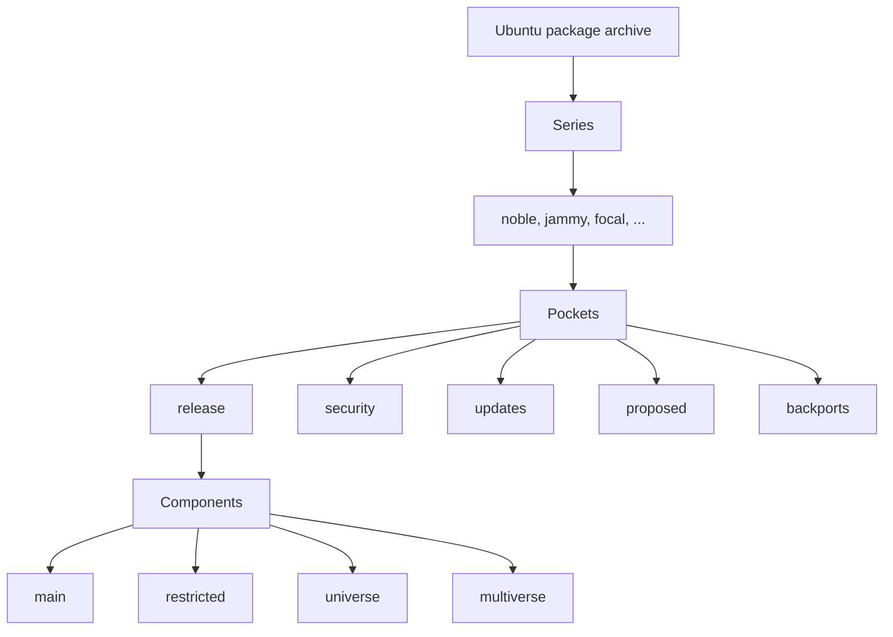

# ubuntu-info-rust

Ubuntu distribution information modeled for Rust applications.

`ubuntu-info-rust` is a dependency-light Rust library that models Ubuntu
distribution information as static data structures and enums. It is a
compile-time source of truth for Ubuntu series, archive pockets, suites,
components, machine architectures, and archive locations. The crate performs no
network requests and reads no system files. Series lookups use compile-time
perfect hash maps, so they are O(1) in the number of series.

All public types implement serde's `Serialize` and `Deserialize` traits when
the optional `serde` feature is enabled, so they can be used directly in
configuration files and other serialized formats.

## Installation

Add the crate to `Cargo.toml`:

```toml
[dependencies]
ubuntu-info-rust = "0.1"
```

Enable the optional `serde` feature to serialize and deserialize the crate's
types:

```toml
[dependencies]
ubuntu-info-rust = { version = "0.1", features = ["serde"] }
```

For local development against a checkout, use a path dependency:

```toml
[dependencies]
ubuntu-info-rust = { path = "../ubuntu-info-rust" }
```

## Quick start

```rust
use ubuntu_info_rust::{Pocket, SeriesInfo, Suite};

fn main() {
    // Look up a series by version. The LTS suffix is optional.
    let resolute = SeriesInfo::from_version("26.04 LTS").unwrap();
    println!("{} is {}", resolute.version, resolute.code_name);

    // Look up a series by full or short code name.
    let stonking = SeriesInfo::from_code_name("Stonking Stingray").unwrap();
    assert_eq!(stonking.code_name_short, "stonking");

    // Parse a suite and inspect its series and pocket.
    let suite: Suite = "jammy-security".parse().unwrap();
    assert_eq!(suite.series.code_name_short, "jammy");
    assert_eq!(suite.pocket, Pocket::Security);

    // Iterate the series that are currently supported.
    for series in SeriesInfo::active() {
        println!("{} {}", series.version, series.code_name);
    }
}
```

## Runnable examples

The [`examples/`](examples/) directory contains small programs that demonstrate
the public API. Run them with `cargo run --example <name>`:

| Example | Command | Shows |
| --- | --- | --- |
| `series_lookup` | `cargo run --example series_lookup` | Version and code-name lookups, including `devel` |
| `lifecycle` | `cargo run --example lifecycle` | Active, ESM, legacy, end-of-life, and development series |
| `suites` | `cargo run --example suites` | Parsing and formatting suites, including `devel` aliases |
| `archive_urls` | `cargo run --example archive_urls` | Building archive URLs for suites, components, and architectures |
| `components_and_architectures` | `cargo run --example components_and_architectures` | Component classification and architecture metadata |

## Usage

### Look up a series

`SeriesInfo::from_version` accepts a plain version, an optional `Ubuntu` prefix,
an optional `LTS` suffix, and LTS point releases:

```rust
use ubuntu_info_rust::SeriesInfo;

let cases = [
    ("26.04", "resolute"),
    ("26.04 LTS", "resolute"),
    ("26.04.1 LTS", "resolute"),
    ("Ubuntu 24.04 LTS", "noble"),
    ("24.04.1 LTS", "noble"),
];

for (input, expected) in cases {
    let series = SeriesInfo::from_version(input).unwrap();
    assert_eq!(series.code_name_short, expected);
}
```

An LTS suffix or point release is rejected for a non-LTS series:

```rust
use ubuntu_info_rust::SeriesInfo;

assert!(SeriesInfo::from_version("26.10 LTS").is_none());
assert!(SeriesInfo::from_version("26.10.1").is_none());
```

`SeriesInfo::from_code_name` accepts both the full code name and the short code
name. Matching is ASCII case-insensitive:

```rust
use ubuntu_info_rust::SeriesInfo;

let full = SeriesInfo::from_code_name("Stonking Stingray").unwrap();
let short = SeriesInfo::from_code_name("stonking").unwrap();
assert_eq!(full, short);
```

### Inspect lifecycle information

Each `SeriesInfo` exposes its release date, end of standard support, end of
life, and optional ESM and legacy-support start dates:

```rust
use ubuntu_info_rust::SeriesInfo;

let jammy = SeriesInfo::from_version("22.04").unwrap();
println!("Released:                 {}", jammy.release_date);
println!("Standard support ends:    {}", jammy.end_of_standard_support);
println!("End of life:              {}", jammy.end_of_life);
println!("ESM starts:               {:?}", jammy.esm_start);
println!("Legacy support starts:    {:?}", jammy.legacy_start);
println!("LTS:                      {}", jammy.is_lts);
```

Use `lifecycle_on` to evaluate a phase on a specific date:

```rust
use ubuntu_info_rust::{Date, Lifecycle, SeriesInfo};

let xenial = SeriesInfo::from_version("16.04").unwrap();

assert_eq!(
    xenial.lifecycle_on(Date::new(2018, 1, 1)),
    Lifecycle::StandardSupport
);
assert_eq!(
    xenial.lifecycle_on(Date::new(2022, 1, 1)),
    Lifecycle::ExpandedSecurityMaintenance
);
assert_eq!(
    xenial.lifecycle_on(Date::new(2027, 1, 1)),
    Lifecycle::LegacySupport
);
assert_eq!(
    xenial.lifecycle_on(Date::new(2032, 1, 1)),
    Lifecycle::EndOfLife
);
```

`SeriesInfo` implements `Ord` by release date, so series sort chronologically.
`Lifecycle` variants are ordered from development through end of life.

### Iterate series groups

The crate provides iterators for the groups used by the Ubuntu release
documentation:

```rust
use ubuntu_info_rust::SeriesInfo;

println!("Active:");
for series in SeriesInfo::active() {
    println!("  {} {}", series.version, series.code_name);
}

println!("Currently in ESM:");
for series in SeriesInfo::current_esm() {
    println!("  {} {}", series.version, series.code_name);
}

println!("Currently in legacy support:");
for series in SeriesInfo::current_legacy() {
    println!("  {} {}", series.version, series.code_name);
}

println!("End of life:");
for series in SeriesInfo::end_of_life() {
    println!("  {} {}", series.version, series.code_name);
}

let devel = SeriesInfo::devel();
println!("Development series: {} {}", devel.version, devel.code_name);
```

`SeriesInfo::all()` iterates every known series in release-date order.

### Work with suites and pockets

A suite is a series plus a pocket. The `release` pocket has no suffix; all other
pockets append `-<pocket>`:

```rust
use ubuntu_info_rust::{Pocket, SeriesInfo, Suite};

let jammy = SeriesInfo::from_version("22.04").unwrap();

let release = Suite::new(jammy, Pocket::Release);
let security = Suite::new(jammy, Pocket::Security);

assert_eq!(release.to_string(), "jammy");
assert_eq!(security.to_string(), "jammy-security");

let parsed: Suite = "jammy-backports".parse().unwrap();
assert_eq!(parsed.series, jammy);
assert_eq!(parsed.pocket, Pocket::Backports);

for pocket in Pocket::ALL {
    println!("{}", Suite::new(jammy, pocket));
}
```

The `devel` alias resolves to the series currently in development:

```rust
use ubuntu_info_rust::{Pocket, SeriesInfo, Suite};

let devel = Suite::devel(Pocket::Security);
assert_eq!(devel.series, SeriesInfo::devel());
assert_eq!(devel.pocket, Pocket::Security);

let parsed: Suite = "devel-security".parse().unwrap();
assert_eq!(parsed, devel);
```

`Suite` implements `Ord` by its series, then its pocket, so suites sort by
release date and then by pocket order.

### Work with components and architectures

```rust
use ubuntu_info_rust::{Architecture, Component};

for component in Component::ALL {
    println!(
        "{:<12} canonical={} community={} open_source={}",
        component,
        component.is_canonical(),
        component.is_community(),
        component.is_open_source()
    );
}

for architecture in Architecture::ALL {
    println!(
        "{:<8} endianness={:?} officially_supported={}",
        architecture,
        architecture.endianness(),
        architecture.is_officially_supported()
    );
}
```

`i386` is included as a partial port and reports
`is_officially_supported() == false`. `amd64v3` is the `x86-64-v3` architecture
variant introduced in Ubuntu 25.10 and is officially supported.

### Build archive URLs

`Archive` keeps archive hostnames as data and builds the documented
`dists/<suite>/<component>/binary-<arch>/` layout. The primary archive hosts
`amd64`, `amd64v3`, and `i386`; the ports archive hosts `arm64`, `armhf`,
`ppc64el`, `riscv64`, and `s390x`.

```rust
use ubuntu_info_rust::{Architecture, Archive, Component, Pocket, SeriesInfo, Suite};

let suite = Suite::new(
    SeriesInfo::from_version("26.04 LTS").unwrap(),
    Pocket::Security,
);

assert_eq!(
    Archive::Security.dists_url(&suite, Component::Main, Architecture::Amd64),
    "http://security.ubuntu.com/ubuntu/dists/resolute-security/main/binary-amd64/"
);

assert_eq!(
    Archive::Primary.dists_url(&suite, Component::Universe, Architecture::Amd64v3),
    "http://archive.ubuntu.com/ubuntu/dists/resolute-security/universe/binary-amd64v3/"
);

assert_eq!(
    Archive::Ports.dists_url(&suite, Component::Main, Architecture::Arm64),
    "http://ports.ubuntu.com/ubuntu-ports/dists/resolute-security/main/binary-arm64/"
);

assert_eq!(
    Archive::country("fi").base_url(),
    "http://fi.archive.ubuntu.com/ubuntu"
);
```

Each architecture also knows which archive hosts it, so you can build URLs
without choosing an `Archive` yourself:

```rust
use ubuntu_info_rust::{Architecture, Component, Pocket, SeriesInfo, Suite};

let suite = Suite::new(
    SeriesInfo::from_version("26.04 LTS").unwrap(),
    Pocket::Security,
);

assert_eq!(
    Architecture::Amd64.archive_url(),
    "http://archive.ubuntu.com/ubuntu"
);
assert_eq!(
    Architecture::Amd64v3.archive_url(),
    "http://archive.ubuntu.com/ubuntu"
);
assert_eq!(
    Architecture::Arm64.archive_url(),
    "http://ports.ubuntu.com/ubuntu-ports"
);
assert_eq!(
    Architecture::Arm64.security_archive_url(),
    "http://ports.ubuntu.com/ubuntu-ports"
);

assert_eq!(
    Architecture::Arm64.dists_url(&suite, Component::Main),
    "http://ports.ubuntu.com/ubuntu-ports/dists/resolute-security/main/binary-arm64/"
);
assert_eq!(
    Architecture::Amd64.security_dists_url(&suite, Component::Main),
    "http://security.ubuntu.com/ubuntu/dists/resolute-security/main/binary-amd64/"
);
```

### Serialize and deserialize

With the optional `serde` feature enabled, all public types implement serde's
`Serialize` and `Deserialize` traits. Enums use their canonical identifiers, and
`Date` uses the `YYYY-MM-DD` form:

```rust
use ubuntu_info_rust::{Architecture, Date, Pocket, Suite};

assert_eq!(
    serde_json::to_string(&Architecture::Amd64v3).unwrap(),
    "\"amd64v3\""
);
assert_eq!(
    serde_json::to_string(&Pocket::Security).unwrap(),
    "\"security\""
);
assert_eq!(
    serde_json::to_string(&Date::new(2026, 4, 23)).unwrap(),
    "\"2026-04-23\""
);

let suite: Suite = "jammy-security".parse().unwrap();
let json = serde_json::to_string(&suite).unwrap();
assert_eq!(serde_json::from_str::<Suite>(&json).unwrap(), suite);
```

`SeriesInfo` and `Suite` contain `&'static` references. Deserializing them
resolves the series against the built-in data, so the input must describe a
known series exactly. Deserializing `Archive::Country` allocates and leaks the
country code so it can be stored with a `'static` lifetime.

## API overview

| Type | Purpose |
| --- | --- |
| `SeriesInfo` | Series metadata and lifecycle dates |
| `Lifecycle` | Development, standard support, ESM, legacy support, or end of life |
| `Pocket` | `release`, `security`, `updates`, `proposed`, `backports` |
| `Component` | `main`, `restricted`, `universe`, `multiverse` |
| `Architecture` | Supported machine architectures |
| `Endianness` | Little- or big-endian |
| `Suite` | A series plus a pocket |
| `Archive` | Primary, security, ports, or country-mirror archive |
| `Date` | Dependency-free calendar date |
| `ParseError` | Descriptive parsing error |

Key `SeriesInfo` methods:

| Method | Returns |
| --- | --- |
| `all()` | Every known series, ordered by release date |
| `from_version(input)` | `Option<&'static SeriesInfo>` |
| `from_code_name(input)` | `Option<&'static SeriesInfo>` |
| `from_short_name(input)` | `Option<&'static SeriesInfo>` |
| `devel()` | The current development series |
| `active()` | Released series that are still supported |
| `esm()` | Series that have entered ESM |
| `current_esm()` | Series currently in the ESM phase |
| `legacy()` | Series that have entered legacy support |
| `current_legacy()` | Series currently in the legacy phase |
| `end_of_life()` | Series that have reached end of life |
| `lifecycle_on(date)` | The lifecycle phase on a date |
| `is_active_on(date)` | Whether the series is supported on a date |
| `is_esm_on(date)` | Whether the series is in ESM on a date |
| `is_legacy_on(date)` | Whether the series is in legacy support on a date |
| `is_end_of_life_on(date)` | Whether the series is end-of-life on a date |

Key `Architecture` methods:

| Method | Returns |
| --- | --- |
| `archive()` | The primary `Archive` that hosts the architecture |
| `security_archive()` | The security `Archive` that hosts the architecture |
| `archive_url()` | The base URL of the architecture's primary archive |
| `security_archive_url()` | The base URL of the architecture's security archive |
| `dists_url(suite, component)` | The full primary-archive URL for a suite and component |
| `security_dists_url(suite, component)` | The full security-archive URL for a suite and component |

## Performance

Series lookups (`from_version`, `from_code_name`, `from_short_name`, and
`devel`) are O(1) in the number of series. They use compile-time perfect hash
maps generated by [`phf`](https://crates.io/crates/phf), so there is no runtime
map initialization and no linear scan.

The iterators (`all`, `active`, `esm`, `legacy`, `end_of_life`, and the
`current_*` variants) are O(n) by nature because they visit every matching
series. They are intended for enumeration, not repeated point lookups.

## Data model



### Lifecycle semantics

- Dates are inclusive: a series remains in a phase through the last day of that
  phase.
- `REFERENCE_DATE` is the date on which the series data was last verified. The
  `active`, `esm`, `legacy`, and `end_of_life` iterators use it.
- `active()` includes series in standard support, ESM, and legacy support. It
  excludes the unreleased development series.
- `esm()` and `legacy()` include series that have entered those phases, even if
  they have since moved on. Use `current_esm()` and `current_legacy()` for the
  series currently in those phases.
- `devel()` is the unreleased series with the earliest release date relative to
  `REFERENCE_DATE`. The `devel` code name and suite aliases resolve to it.
- Where an upstream source only specifies a month, start dates use the first day
  of the month and end dates use the last day of the month.
- For LTS series before 12.04, the server lifecycle is used.

## Updating the data

The series data lives in `SERIES` in [`src/series.rs`](src/series.rs). To update
it:

1. Update or add `SeriesInfo` entries in release-date order.
2. Update the `VERSION_INDEX`, `SHORT_NAME_INDEX`, and `FULL_NAME_INDEX` maps in
   `src/series.rs` so each key points at the correct index in `SERIES`.
3. Update `DEVEL_INDEX` if the development series changes.
4. Update `REFERENCE_DATE` when the data has been re-verified.
5. Use `Date::year_month` for month-precision start dates and
   `Date::end_of_month` for month-precision end dates.
6. Run the test suite. The tests enforce unique identifiers, release-date order,
   consistent lifecycle dates, and that every lookup map matches `SERIES`.
7. Update this README and the examples if the public API or supported data
   changes.

Authoritative sources:

- [How Ubuntu is made: package archive](https://ubuntu.com/project/docs/how-ubuntu-is-made/concepts/package-archive/)
- [List of Ubuntu releases](https://ubuntu.com/project/docs/release-team/list-of-releases/)
- [Supported architectures](https://ubuntu.com/project/docs/how-ubuntu-is-made/concepts/supported-architectures/)

## Development

Run the same checks as CI:

```sh
cargo fmt -- --check
cargo clippy --locked --all-targets --all-features -- -D warnings
RUSTDOCFLAGS="-D warnings" cargo doc --locked --no-deps --all-features
cargo build --locked --all-targets --all-features
cargo test --locked --all-targets --all-features
cargo test --locked --doc
cargo audit
```

The crate's only required runtime dependency is `phf`, used for compile-time
perfect hash maps. `serde` is optional and enabled with the `serde` feature.
`cargo audit` is still part of the repository's pre-commit hook and CI workflow.
